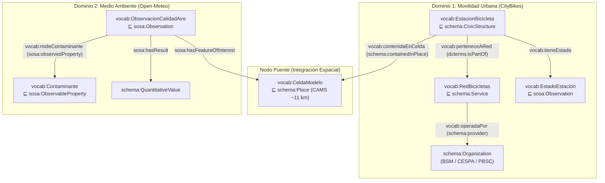

# Modelo de Datos Tentativo del Grafo de Conocimiento (RDF / RDFS / OWL / SOSA)

**Proyecto:** Grafo de Conocimiento para Smart City Barcelona — Movilidad Sostenible (CityBikes Bicing) y Calidad del Aire (Open-Meteo CAMS)  
**Asignatura:** Interoperabilidad y Explotación de Datos en Ecosistemas Heterogéneos  
**Autores:** Alex Gutiérrez, David Emanuel Toa  
**Fecha:** Noviembre 2026  

---

## 1. Fundamentos y Principios de Diseño Ontológico

El presente modelo tentativo ha sido diseñado siguiendo las recomendaciones de la **W3C**, el esquema de 5 estrellas de **Linked Open Data** y los criterios metodológicos impartidos en las cátedras (Clases 4, 6 y 7):

1. **Separación Estricta de Instancias y Vocabulario:**  
   Se definen dos espacios de nombres independientes bajo el dominio del proyecto para evitar la colisión semántica observada en borradores previos:
   - Namespace ontológico (Clases y Propiedades): `http://example.org/bcn-kg/vocab#` (prefijo `vocab:`)
   - Namespace de individuos e instancias físicas: `http://example.org/bcn-kg/data/` (prefijo `data:`)
2. **Higiene Rigurosa de URIs:**  
   Se prohíbe el uso de caracteres especiales, comas, dos puntos internos o espacios en los identificadores locales. Las URIs se componen exclusivamente de letras, números, guiones y barras.
3. **Reutilización de Vocabularios Estándar (Antes de Inventar):**  
   Se alinean los conceptos con vocabularios de amplio consenso internacional:
   - **Schema.org (`schema:`)**: Para entidades de servicio urbano, organizaciones, lugares y estructuras cívicas.
   - **SOSA / SSN (`sosa:`, W3C Recommendation)**: Para el modelado de observaciones de sensores y series temporales diacrónicas.
   - **Basic Geo WGS84 (`geo:`)**: Para las coordenadas latitud/longitud puntuales.
   - **Dublin Core Terms (`dcterms:`)**: Para metadatos de procedencia y relaciones de composición.
4. **Respeto a Dominios y Rangos (`rdfs:domain` y `rdfs:range`):**  
   Toda propiedad reutilizada o propia restringe formalmente la clase de su sujeto y el tipo de dato o clase de su objeto.
5. **Mapeo Ontológico (`rdfs:subClassOf` y `rdfs:subPropertyOf`):**  
   Cada término propio se conecta jerárquicamente a un concepto genérico estándar para maximizar la interoperabilidad semántica.

---

## 2. Decisiones Arquitectónicas Clave (Corrección de Defectos Previos)

### A. Desacoplamiento entre Estación Física y Estado Dinámico (SOSA)
- **Problema previo:** En el Entregable 1 preliminar, `free_bikes` y `empty_slots` se modelaban como atributos directos de la entidad `Estacion`. Esto rompía la semántica temporal: si se capturan múltiples horas, el grafo acumula valores contradictorios para el mismo sujeto sin dimensión temporal válida.
- **Solución implementada:** La entidad física `vocab:EstacionBicicleta` es permanente. Cada corte horario genera un recurso independiente `vocab:EstadoEstacion` (subclase de `sosa:Observation`), vinculado a la estación mediante `vocab:tieneEstado`. De esta forma, el grafo escala horizontal y verticalmente a lo largo de 24, 48 o más horas sin alterar la definición de la estación.

### B. Corrección del "Nodo Puente": Celda del Modelo Atmosférico
- **Problema previo:** El modelo inicial utilizaba un recurso ficticio `PuntoEspacial` con `geo:location`, afirmando erróneamente que la estación y el contaminante compartían la misma coordenada física a nivel de acera. En la realidad, Open-Meteo entrega estimaciones de celdas regionales del Servicio de Monitoreo de la Atmósfera de Copernicus (**CAMS**), con resolución de ~11 km (0.1°).
- **Solución implementada:** Se modela explícitamente la clase `vocab:CeldaModelo` (subclase de `schema:Place`). La relación semántica es `vocab:contenidaEnCelda` (subpropiedad de `schema:containedInPlace`). Cada estación conserva sus coordenadas GPS puntuales y se conecta a la celda que cubre su área, complementándose con la propiedad `vocab:distanciaACentroideKm`.

---

## 3. Diagrama Conceptual del Grafo



---

## 4. Especificación Detallada de Clases y Propiedades

### 4.1 Clases

| Clase (URI) | Superclase / Mapeo | Etiqueta (`rdfs:label`) | Descripción Semántica (`rdfs:comment`) |
|---|---|---|---|
| `vocab:RedBicicletas` | `schema:Service` | Red de Bicicletas Compartidas | Infraestructura o servicio metropolitano de transporte en bicicleta pública compartida. |
| `vocab:EstacionBicicleta` | `schema:CivicStructure` | Estación de Bicicletas | Punto físico anclado en vía pública para el préstamo y devolución de bicicletas. |
| `vocab:CeldaModelo` | `schema:Place` | Celda de Modelo Atmosférico | Unidad de cuadrícula espacial (~11 km) del modelo CAMS utilizada por Open-Meteo. |
| `vocab:EstadoEstacion` | `sosa:Observation` | Estado Dinámico de la Estación | Observación atómica del inventario operativo (bicicletas y anclajes) en un instante UTC. |
| `vocab:ObservacionCalidadAire` | `sosa:Observation` | Observación de Calidad del Aire | Estimación horaria de contaminantes en una celda atmosférica. |
| `vocab:Contaminante` | `sosa:ObservableProperty` | Contaminante Atmosférico | Variable química/física analizada (NO2, PM10, PM2.5). |

### 4.2 Propiedades de Objetos (Relaciones)

| Propiedad (URI) | Dominio (`rdfs:domain`) | Rango (`rdfs:range`) | Mapeo Estándar | Propósito en el Grafo |
|---|---|---|---|---|
| `vocab:perteneceARed` | `vocab:EstacionBicicleta` | `vocab:RedBicicletas` | `dcterms:isPartOf` | Agrupación de estaciones en la red Bicing. |
| `vocab:operadaPor` | `vocab:RedBicicletas` | `schema:Organization` | `schema:provider` | Identificación de entidades operadoras. |
| `vocab:contenidaEnCelda` | `vocab:EstacionBicicleta` | `vocab:CeldaModelo` | `schema:containedInPlace` | **Nodo Puente:** Enlace espacial WGS84 estación ↔ celda CAMS. |
| `vocab:tieneEstado` | `vocab:EstacionBicicleta` | `vocab:EstadoEstacion` | `sosa:hasObservation` | Vinculación de estaciones con capturas temporales. |
| `vocab:mideContaminante` | `vocab:ObservacionCalidadAire` | `vocab:Contaminante` | `sosa:observedProperty` | Especificación del agente químico medido. |

### 4.3 Propiedades de Datos (Atributos)

| Propiedad (URI) | Dominio (`rdfs:domain`) | Rango (`rdfs:range`) | Ejemplo de Valor |
|---|---|---|---|
| `schema:name` | `vocab:EstacionBicicleta` | `xsd:string` | `"PL JOANIC - C / BRUNIQUER, 59"` |
| `schema:identifier` | `vocab:EstacionBicicleta` | `xsd:string` | `"119"` (UID municipal) |
| `geo:lat` | `vocab:EstacionBicicleta` / `vocab:CeldaModelo` | `xsd:decimal` | `"41.40552"^^xsd:decimal` |
| `geo:long` | `vocab:EstacionBicicleta` / `vocab:CeldaModelo` | `xsd:decimal` | `"2.16225"^^xsd:decimal` |
| `vocab:distanciaACentroideKm` | `vocab:EstacionBicicleta` | `xsd:decimal` | `"3.2140"^^xsd:decimal` |
| `vocab:bicicletasDisponibles` | `vocab:EstadoEstacion` | `xsd:nonNegativeInteger` | `"4"^^xsd:nonNegativeInteger` |
| `vocab:anclajesLibres` | `vocab:EstadoEstacion` | `xsd:nonNegativeInteger` | `"3"^^xsd:nonNegativeInteger` |
| `vocab:bicicletasElectricas` | `vocab:EstadoEstacion` | `xsd:nonNegativeInteger` | `"3"^^xsd:nonNegativeInteger` |
| `vocab:bicicletasMecanicas` | `vocab:EstadoEstacion` | `xsd:nonNegativeInteger` | `"1"^^xsd:nonNegativeInteger` |
| `vocab:enLinea` | `vocab:EstadoEstacion` | `xsd:boolean` | `"true"^^xsd:boolean` |
| `sosa:resultTime` | `vocab:EstadoEstacion` / `vocab:ObservacionCalidadAire` | `xsd:dateTime` | `"2026-11-12T13:00:00Z"^^xsd:dateTime` |
| `schema:value` | `schema:QuantitativeValue` | `xsd:decimal` | `"42.50"^^xsd:decimal` |
| `schema:unitText` | `schema:QuantitativeValue` | `xsd:string` | `"µg/m³"` |

---

## 5. Muestra de Tripletas Instanciadas (Sintaxis Turtle)

```turtle
@prefix schema:  <https://schema.org/> .
@prefix sosa:    <http://www.w3.org/ns/sosa/> .
@prefix geo:     <http://www.w3.org/2003/01/geo/wgs84_pos#> .
@prefix vocab:   <http://example.org/bcn-kg/vocab#> .
@prefix data:    <http://example.org/bcn-kg/data/> .
@prefix xsd:     <http://www.w3.org/2001/XMLSchema#> .

# Instancia de Estación Física (Permanente)
data:estacion_00028670e3d01438515caba403ffd680
    a vocab:EstacionBicicleta ;
    schema:name "PL JOANIC - C / BRUNIQUER, 59"@es ;
    schema:identifier "119" ;
    geo:lat "41.40552"^^xsd:decimal ;
    geo:long "2.16225"^^xsd:decimal ;
    vocab:distanciaACentroideKm "3.2140"^^xsd:decimal ;
    vocab:contenidaEnCelda data:celda_41.40_2.20 ;
    vocab:perteneceARed data:red_bicing .

# Instancia de Celda Atmosférica CAMS (Nodo Puente)
data:celda_41.40_2.20
    a vocab:CeldaModelo ;
    schema:name "Celda CAMS Barcelona Norte-Litoral"@es ;
    geo:lat "41.40000"^^xsd:decimal ;
    geo:long "2.20000"^^xsd:decimal ;
    schema:elevation "44.0"^^xsd:decimal .

# Observación Dinámica de Movilidad (Captura 13:00 UTC)
data:estado_00028670_20261112_1300
    a vocab:EstadoEstacion ;
    vocab:tieneEstado data:estacion_00028670e3d01438515caba403ffd680 ;
    sosa:resultTime "2026-11-12T13:00:00Z"^^xsd:dateTime ;
    vocab:bicicletasDisponibles "4"^^xsd:nonNegativeInteger ;
    vocab:anclajesLibres "3"^^xsd:nonNegativeInteger ;
    vocab:bicicletasElectricas "3"^^xsd:nonNegativeInteger ;
    vocab:bicicletasMecanicas "1"^^xsd:nonNegativeInteger ;
    vocab:enLinea "true"^^xsd:boolean .

# Observación Ambiental Sincronizada (Celda 41.40_2.20 a las 13:00 UTC)
data:obs_celda_41.40_2.20_NO2_20261112_1300
    a vocab:ObservacionCalidadAire ;
    sosa:hasFeatureOfInterest data:celda_41.40_2.20 ;
    vocab:mideContaminante data:contaminante_NO2 ;
    sosa:resultTime "2026-11-12T13:00:00Z"^^xsd:dateTime ;
    sosa:hasResult [
        a schema:QuantitativeValue ;
        schema:value "41.80"^^xsd:decimal ;
        schema:unitText "µg/m³"
    ] .
```
