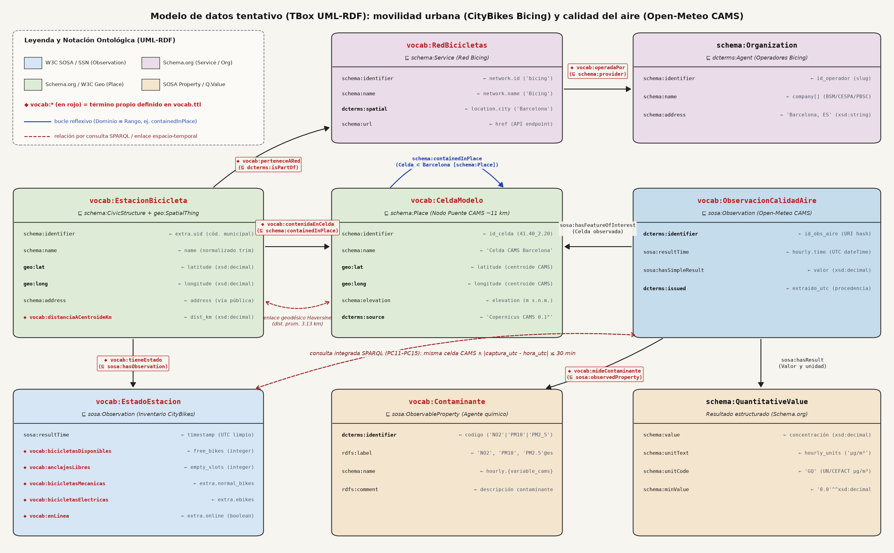
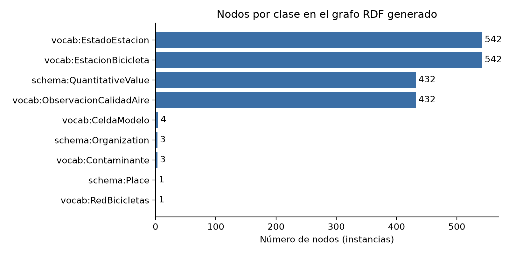
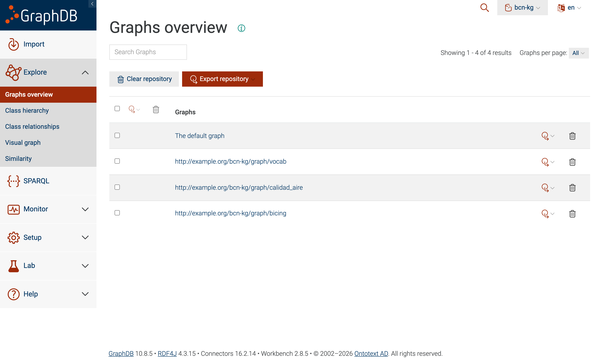
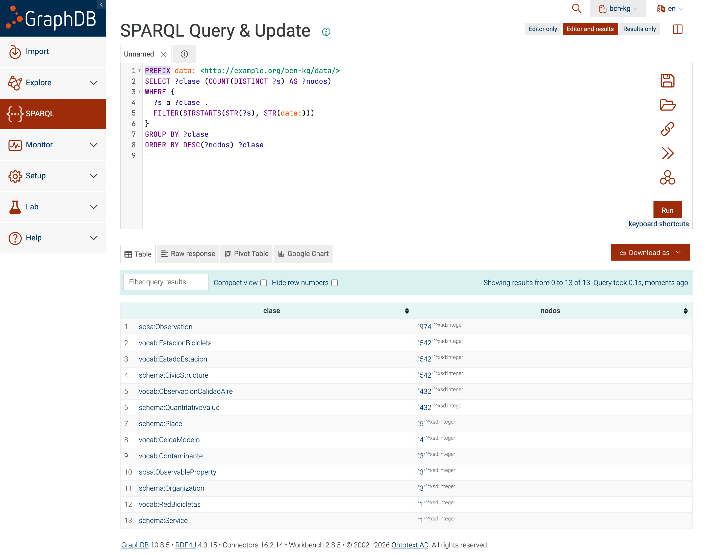
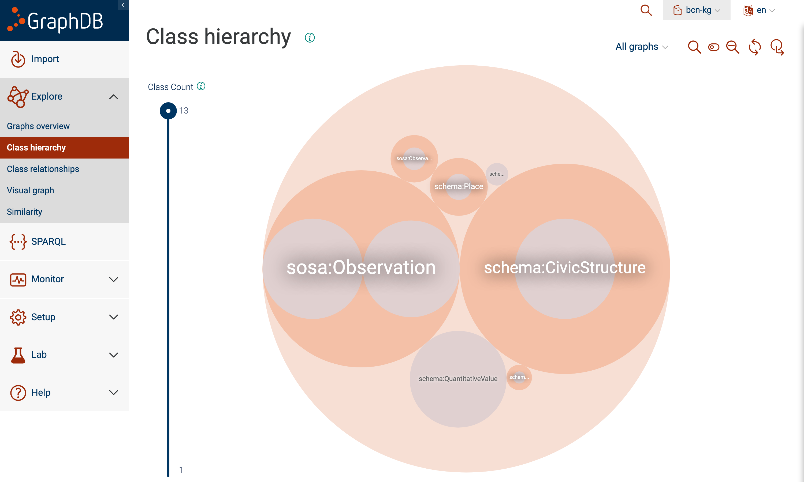
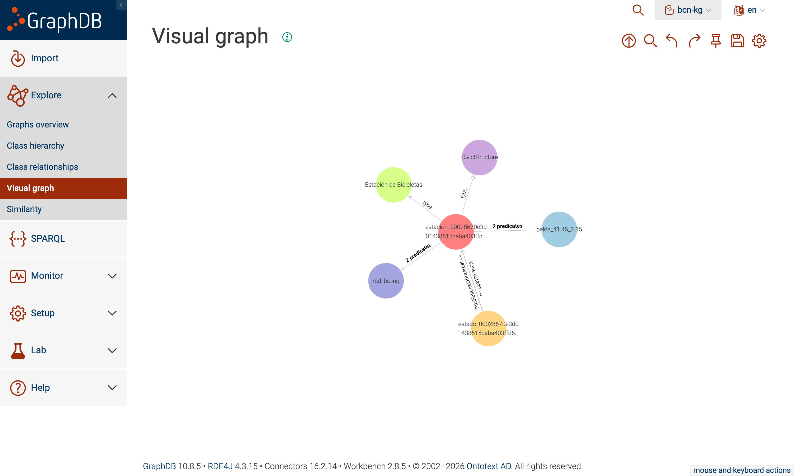
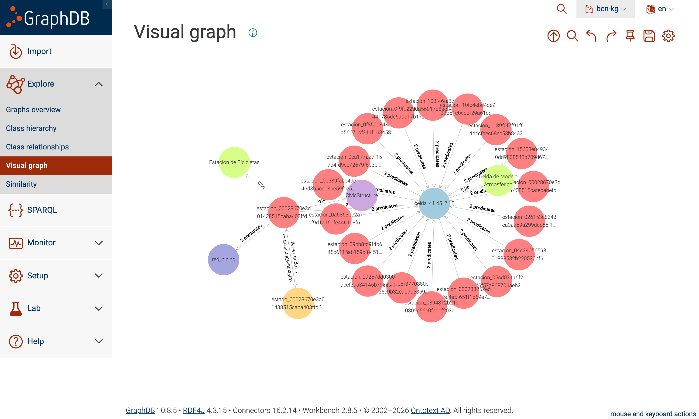

# Grafo de Conocimiento Smart City Barcelona: movilidad y calidad del aire

**Universidad Técnica Particular de Loja (UTPL)**
**Asignatura:** Interoperabilidad y Explotación de Datos en Ecosistemas Heterogéneos
**Docente:** Dra. Janneth Alexandra Chicaiza Espinosa
**Integrantes:** Alex Gutiérrez, David Manotoa
**Fecha:** 25 de noviembre de 2026

Informe de la práctica bimestral: Fase 1 (especificación), Fase 2 (extracción, limpieza y modelo) y Fase 3 (generación de datos RDF y almacenamiento en GraphDB).

## 1. Fase 1 — Especificación del dominio y de las fuentes

### 1.1 Dominio y problema

El proyecto integra dos ámbitos de las Smart Cities en Barcelona (España): la **movilidad urbana sostenible** (sistema público de bicicletas Bicing) y el **medio ambiente** (contaminación atmosférica). Cuando los ciclistas se desplazan por zonas con concentraciones elevadas de dióxido de nitrógeno (NO2) y material particulado (PM10, PM2.5), el esfuerzo físico aumenta la dosis de contaminantes inhalada. Los datos necesarios para analizar este fenómeno están aislados en sistemas distintos; el grafo de conocimiento los integra para que el Ajuntament, los planificadores urbanos y los ciclistas puedan cruzar disponibilidad de bicicletas y calidad del aire.

### 1.2 Fuentes de datos seleccionadas

| Fuente | Publicador | Acceso | Formato | Licencia | Contenido |
|---|---|---|---|---|---|
| CityBikes (red Bicing) | Proyecto CityBikes / BSM, CESPA, PBSC | API REST abierta `api.citybik.es/v2/networks/bicing` | JSON | ODbL / CC BY 4.0 | 542 estaciones: ubicación, bicicletas mecánicas y eléctricas, anclajes libres, estado en línea |
| Open-Meteo Air Quality (CAMS) | Open-Meteo / Copernicus CAMS | API REST abierta `air-quality-api.open-meteo.com/v1/air-quality` | JSON | CC BY 4.0 | Concentración horaria de NO2, PM10 y PM2.5 en celdas de 0.1° (~11 km) |

### 1.3 Preguntas de competencia

Se definieron 15 preguntas de competencia: PC1–PC5 sobre la red Bicing (disponibilidad, saturación, cercanía, bicicletas eléctricas, capacidad), PC6–PC10 sobre la calidad del aire (NO2 por celda, excedencias de PM10 y PM2.5, amplitud espacial, razón PM2.5/PM10) y PC11–PC15 **integradas**, que cruzan el estado de las estaciones con la contaminación de la celda que las contiene (por ejemplo, PC11: estaciones con al menos 5 bicicletas disponibles en celdas con NO2 ≤ 25 μg/m³ en la misma hora).

### 1.4 Estrategia de enlace

Las dos fuentes no comparten identificadores. El enlace se hace a través de un **nodo puente**: la celda del modelo CAMS (`vocab:CeldaModelo`). Cada estación se asocia a la celda que la contiene (`vocab:contenidaEnCelda`) y las observaciones de calidad del aire se refieren a esa misma celda (`sosa:hasFeatureOfInterest`). El enlace temporal se hace por la hora UTC de cada observación (`sosa:resultTime`).

## 2. Fase 2 — Extracción, limpieza y modelo de datos

### 2.1 Extracción

Se implementó un pipeline reproducible en Python (`E2_extraccion/src/bcn_kg/`) que descarga ambas APIs y guarda cada respuesta cruda en JSON junto con su procedencia (URL, fecha UTC de extracción y código HTTP) en `data/raw/` y `data/processed/procedencia.csv`.

### 2.2 Limpieza e integración

- Normalización de los nombres de estaciones (espacios dobles y separadores).
- Corrección de marcas de tiempo con formato inválido `+00:00Z` y conversión a UTC.
- Desanidación de las series horarias vectoriales de Open-Meteo a observaciones atómicas (celda, hora, contaminante, valor, unidad).
- Eliminación de duplicados por clave (estación; estación + captura; celda + hora + contaminante).
- Registro de 8 incidencias de calidad (estaciones donde bicicletas mecánicas + eléctricas ≠ bicicletas disponibles) en `incidencias_calidad.csv`.
- Enlace espacial estación → celda y enlace temporal estado → observación (ventana de ±30 min).

Los datos limpios quedaron en 9 archivos CSV; el pipeline tiene 7 pruebas unitarias (`pytest`) que pasan.

### 2.3 Modelo de datos

El modelo reutiliza vocabularios estándar (`schema:`, `sosa:`, `geo:`, `dcterms:`) y define en `vocab.ttl` seis clases propias y once propiedades con dominio y rango declarados.

| Clase | Superclase | Representa |
|---|---|---|
| `vocab:RedBicicletas` | `schema:Service` | La red Bicing |
| `schema:Organization` | — | Operadores de la red (BSM, CESPA, PBSC) |
| `vocab:EstacionBicicleta` | `schema:CivicStructure` | Estación física |
| `vocab:EstadoEstacion` | `sosa:Observation` | Inventario de una estación en un instante |
| `vocab:CeldaModelo` | `schema:Place` | Celda CAMS de 0.1° (nodo puente) |
| `vocab:ObservacionCalidadAire` | `sosa:Observation` | Concentración horaria de un contaminante en una celda |
| `vocab:Contaminante` | `sosa:ObservableProperty` | NO2, PM10, PM2.5 |
| `schema:QuantitativeValue` | — | Valor y unidad del resultado |
| `schema:Place` | — | Barcelona |

## 3. Fase 3 — Generación de datos RDF y almacenamiento

### 3.1 Preprocesamiento previo a la conversión

Al revisar los datos antes de convertirlos se detectó que las dos celdas CAMS del Entregable 2 tenían **exactamente los mismos valores** de contaminación. La causa: Open-Meteo devuelve en `latitude`/`longitude` una coordenada redondeada (41.4, 2.2) que no identifica la celda real. De los 6 puntos consultados, 5 respondieron "41.4, 2.2" pero con 3 series distintas; al usar esa coordenada como identificador se fusionaron celdas diferentes y se perdieron 2 series.

La rejilla CAMS Europa es de 0.1° con centros en múltiplos de 0.05. El script `E3_rdf/scripts/preprocesar.py` asigna cada punto consultado y cada estación a su celda con `floor(coordenada × 10) / 10` y **verifica** que todos los puntos de una misma celda traen series idénticas (si no, el proceso falla). Resultado:

| Celda | Puntos consultados | Estaciones | ¿Tiene observaciones? |
|---|---|---|---|
| `celda_41.35_2.15` | 3 | 301 | Sí |
| `celda_41.45_2.15` | 2 | 193 | Sí |
| `celda_41.35_2.25` | 1 | 6 | Sí |
| `celda_41.45_2.25` | 0 | 42 | No (no fue muestreada en la captura) |

Las observaciones pasan de 288 (2 celdas con datos duplicados) a 432 (3 celdas × 48 horas × 3 contaminantes).

### 3.2 Esquema de identificación de URIs

Todas las entidades de ambas fuentes usan la misma URI base `http://example.org/bcn-kg/data/` (prefijo `data:`). La URI se forma con el identificador natural de la entidad, aplicando la misma función `normalizar` en las dos fuentes: se quitan tildes y caracteres especiales y los espacios se reemplazan por `_`. Para las estaciones se usa el identificador de CityBikes y no el nombre, porque los nombres de calle se repiten.

| Clase | Patrón de URI |
|---|---|
| `vocab:RedBicicletas` | `data:red_bicing` |
| `schema:Organization` | `data:organizacion_<nombre>` |
| `vocab:EstacionBicicleta` | `data:estacion_<id>` |
| `vocab:EstadoEstacion` | `data:estado_<id>_<fecha>` |
| `vocab:CeldaModelo` | `data:celda_<lat>_<lon>` |
| `vocab:Contaminante` | `data:contaminante_<código>` (las mismas URIs declaradas en `vocab.ttl`) |
| `vocab:ObservacionCalidadAire` | `data:obs_<celda>_<hora>_<código>` |
| `schema:QuantitativeValue` | `data:resultado_<celda>_<hora>_<código>` |
| `schema:Place` | `data:Barcelona` |

### 3.3 Conversión con RDFLib

El script `E3_rdf/scripts/generar_rdf.py` sigue el procedimiento visto en clase: crea un grafo vacío, registra los prefijos del modelo (`schema:`, `sosa:` y `geo:` se definen con `Namespace`), y por cada fila forma la URI con `URIRef`, la vincula a su clase con `rdf:type`, convierte los atributos a `Literal` con su tipo XSD (`xsd:decimal`, `xsd:nonNegativeInteger`, `xsd:dateTime`, `xsd:boolean`) y la conecta con las entidades relacionadas mediante `g.add()`. Primero se generó una muestra de 2 filas para revisarla a mano y luego el conjunto completo.

Se generan dos archivos, uno por fuente:

| Archivo | Contenido | Tripletas |
|---|---|---|
| `rdf/bicing.ttl` | Red, operadores, estaciones y estados | 9 234 |
| `rdf/calidad_aire.ttl` | Barcelona, celdas, contaminantes, observaciones y resultados | 5 658 |
| **Total** | | **14 892** |

### 3.4 Validación

Antes de guardar, la función `validar` comprueba los datos contra `vocab.ttl`: que cada propiedad `vocab:` respete su dominio y rango (clase o tipo XSD), que todo nodo `data:` usado como objeto esté descrito y que ningún sujeto quede sin tipo. El resultado es **0 errores**. Además se comprobó que las 4 celdas referenciadas desde `bicing.ttl` existen en `calidad_aire.ttl`, es decir, que las dos fuentes quedan enlazadas. Hay 7 pruebas automáticas (`pytest E3_rdf/tests`) que cubren la normalización de URIs, la rejilla CAMS, el enlace entre fuentes y la detección de errores del validador.

### 3.5 Totales de nodos por clase

| Clase | Nodos |
|---|---:|
| `vocab:EstacionBicicleta` | 542 |
| `vocab:EstadoEstacion` | 542 |
| `vocab:ObservacionCalidadAire` | 432 |
| `schema:QuantitativeValue` | 432 |
| `vocab:CeldaModelo` | 4 |
| `schema:Organization` | 3 |
| `vocab:Contaminante` | 3 |
| `vocab:RedBicicletas` | 1 |
| `schema:Place` | 1 |

### 3.6 Almacenamiento en GraphDB

Se usó GraphDB 10.8.5 (Docker `ontotext/graphdb:10.8.5`). El script `E3_rdf/scripts/cargar_graphdb.py` crea el repositorio `bcn-kg` (ruleset RDFS-Plus Optimized) e importa cada archivo en su propio grafo con nombre: `graph/vocab` (`vocab.ttl`), `graph/bicing` (`bicing.ttl`) y `graph/calidad_aire` (`calidad_aire.ttl`). Luego ejecuta las consultas de verificación y guarda sus resultados en `E3_rdf/graphdb/`. El repositorio quedó con 14 986 tripletas explícitas (14 892 de datos + 97 del vocabulario − 3 tripletas de los contaminantes que comparten ambos).

Totales de nodos por clase en GraphDB. Como el repositorio aplica razonamiento RDFS, también se cuentan las superclases inferidas desde `vocab.ttl`: `sosa:Observation` = 542 estados + 432 observaciones = 974; `schema:CivicStructure` = 542 estaciones; `schema:Place` = 4 celdas + Barcelona = 5; `sosa:ObservableProperty` = 3 contaminantes; `schema:Service` = 1 red. Las clases propias coinciden exactamente con la tabla de la sección 3.5.

### 3.7 Consulta integrada entre fuentes

La consulta `sparql/03_estacion_aire.rq` parte de las estaciones (fuente 1) y, a través de la celda común, obtiene el NO2 medio de las observaciones (fuente 2):

| Celda | Estaciones | NO2 medio (μg/m³) |
|---|---:|---:|
| `celda_41.45_2.15` | 193 | 32.05 |
| `celda_41.35_2.15` | 301 | 27.68 |
| `celda_41.35_2.25` | 6 | 17.57 |

Con los datos del Entregable 2 las celdas daban el mismo valor; tras el preprocesamiento cada celda refleja su propia contaminación.

## 4. Conclusiones y limitaciones

- Se integraron dos fuentes heterogéneas en un único grafo RDF de 14 892 tripletas, con una URI base común y enlazado por las celdas CAMS.
- La validación automática contra el modelo y las pruebas unitarias permiten regenerar los datos de forma reproducible.
- El preprocesamiento de la Fase 3 corrigió una fusión incorrecta de celdas heredada de la Fase 2.
- **Limitaciones:** la celda `celda_41.45_2.25` (42 estaciones del noreste) no tiene observaciones porque no se consultó un punto en ella; los datos corresponden a una única captura de CityBikes (12/11/2026) y a 48 horas de CAMS, que incluyen horas de pronóstico posteriores a la captura.

## 5. Declaración de uso de inteligencia artificial generativa

| Herramienta | Tarea | Verificación humana |
|---|---|---|
| Claude Code (Anthropic) | Asistencia en la revisión del repositorio, el preprocesamiento de celdas CAMS, los scripts de generación RDF, el notebook y la redacción de este informe | Revisión del código y de las tripletas generadas con la muestra de 2 filas, ejecución de las pruebas `pytest` y verificación de los totales en GraphDB |
